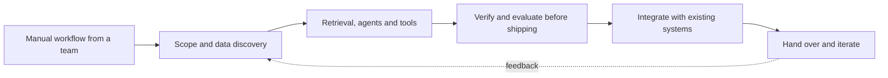

  

---

## 👋 About

I build LLM systems that have to be **right, not just fluent**: agents that cite their evidence, verifiers that drop unsupported claims, and integrations that survive enterprise stacks.

4+ years of backend engineering on financial platforms (**Java, Spring Boot, Kafka, IBM MQ, Oracle**), and the last year in an applied-AI role at **Broadridge**, working like an embedded forward-deployed engineer: teams bring manual, repetitive work, and I scope it, build the AI workflow (RAG assistants, agentic triage, dashboards), integrate it into existing systems, and hand it over.

Outside work, I build multi-agent systems at hackathons, fast, in public, and with the limitations written down.

---

## 🚀 Featured builds (2026 hackathons)

| Project | What it does | Built with |
|:--|:--|:--|
| 🧭 **[TriagePilot](https://github.com/mahesh-mettireddy/TriagePilot)** Google Cloud AI Builder Cup 2026 | Multi-agent incident analyst. Every conclusion ships with verified evidence (Git SHAs, log timestamps) or it doesn't ship. Deterministic verifier, trust gating, principled abstention, audit hash chain. **8/8 root-cause hits vs 4/8 for a single-agent baseline** on its own 8-scenario synthetic benchmark. [Live demo](https://triagepilot-ywgad5nv3a-uc.a.run.app) | `Python` `Google ADK` `Vertex AI Gemini` `A2A` `FastAPI` `Cloud Run` `Firestore` |
| 🕸️ **[FalkorTrace](https://github.com/mahesh-mettireddy/FalkorTrace)** Hackathon build | Multi-agent graph triage and "company brain": multi-hop root-cause analysis across PRDs, code, git patches, and on-call teams through parameterized Cypher. [Live demo](https://falkor-trace.vercel.app) | `Python` `FalkorDB` `MCP` `Cypher` |
| 🥋 **[AIGym-CodeReviewEnv](https://github.com/mahesh-mettireddy/AIGym-CodeReviewEnv)** Meta × Scaler OpenEnv Hackathon | RL evaluation environment that tests whether LLMs can perform senior-level code reviews. | `Python` `Meta OpenEnv` `RL evaluation` |
| 🏥 **MediClear** Google Hyderabad hackathon | Turns voice transcripts, prescription photos, and pill-bottle images into structured pre-authorization payloads for hospital systems. | `Gemini Vision` `Node.js` `Next.js` |
| 💼 **[Wealthpilot_AI](https://github.com/mahesh-mettireddy/Wealthpilot_AI)** | AI wealth advisor: profiles risk appetite, recommends fund allocations, projects investment growth. | `Java` `Spring Boot` `Claude` `AWS` |
| 🛒 **[Retail_Mind](https://github.com/mahesh-mettireddy/Retail_Mind)** | Inventory and demand intelligence for small retailers: stock-out prediction, expiry alerts, recommended actions. | `Java 21` `Spring Boot` `Amazon Bedrock` `AWS Lambda` |

All of these are hackathon builds. Each README states scope and known limitations, and benchmark numbers come from synthetic data I wrote myself.

---

## 🧠 How I build

- **Evidence over eloquence.** A claim without a verifiable source gets dropped, not polished.
- **Evals before polish.** If I can't measure it against a baseline, I don't ship it.
- **Abstain when unsure.** A confident wrong answer is worse than "I need more information."
- **Integrate, don't just demo.** Real systems mean queues, databases, auth, and on-call, so I build for those from day one.
- **Say what it can't do.** Limitations belong in the README.

---

## 🛠️ Toolbox

  

| | |
|:--|:--|
| **AI / LLM** | RAG · multi-agent systems · Google ADK · A2A · MCP · Vertex AI Gemini · Claude · Amazon Bedrock · prompt design · LLM evaluation |
| **Languages** | Python · Java · SQL · TypeScript / JavaScript |
| **Backend** | Spring Boot · FastAPI · REST · Kafka · IBM MQ · Apache Camel · Redis |
| **Data** | Oracle · MS SQL Server · PostgreSQL · FalkorDB (graph) · DynamoDB · Firestore |
| **Cloud / DevOps** | GCP Cloud Run · AWS Lambda · Docker · GitHub Actions |

🎓 **Certified:** Oracle Certified Foundations Associate, Agentic AI · Google Gemini for Developers · Microsoft / LinkedIn Career Essentials in Generative AI

---

## 📬 Let's talk

I'm looking for **AI Engineer** and **Forward Deployed Engineer** roles at strong product companies and startups, especially where AI has to work inside messy, real-world systems.

Best way to reach me: **[LinkedIn](www.linkedin.com/in/mahesh-mettireddy)**.

<!--
OPTIONAL: GitHub stats. These cards depend on third-party hosts and can be rate-limited,
so add them only if they render reliably for you.

  
  

-->

